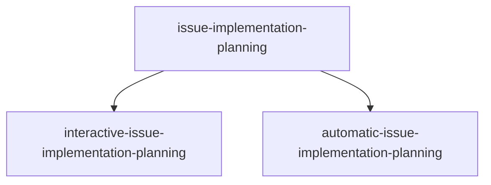

# github-issue-implementation-planner

GitHub issue planning via `gh`: choose interactive (ask-first) or automatic
(assumption-first) mode, plan one or many issues, and decide PR grouping,
merge order, and parallel vs sequential delivery. Planning only.

This is a `maiconfz` community package, not an official agents-repo product.
Installed agents reply in the **language the user used** (English if mixed or
unclear).

## Objective

Turn GitHub issue number(s) or URL(s) into a structured implementation plan
with explicit batch decisions (one PR per issue vs grouped PRs, sequential vs
parallel). **Planning only** — no code changes unless you explicitly request
implementation after the plan is ready.

Successor to `maiconfz/github-interactive-issue-implementation-planner`
(deprecated).

## Workflow



Invoke **`interactive-issue-implementation-planning`** or
**`automatic-issue-implementation-planning`** directly to skip the mode
question. Use **`issue-implementation-planning`** when you want the router to
ask.

## Prerequisites

- [GitHub CLI](https://cli.github.com/) authenticated for target repositories
  (`gh auth status`)
- Local checkout of the repository where you intend to implement
- Node.js with `npx` (see the [agents-repo CLI](https://github.com/agents-repo/cli))

## Install

```bash
npx agents-repo@latest install maiconfz/github-issue-implementation-planner
```

After install, commit `agents.json`, `agents-lock.json`, and extracted paths
when they change.

## Usage

### Inputs

| Input | Required | Description |
| --- | --- | --- |
| `issue-references` | yes | One issue number or URL, or many separated by commas, spaces, or newlines |
| `repository` | no | `owner/name` for bare issue numbers when not inferable |
| `planning-mode` | no | `interactive` or `automatic`; router asks if missing |
| `pr-grouping` | no | `per-issue` (one PR per issue), `related` (same-repo issues that share a change boundary), or `single` (one PR per repository) |
| `execution-topology` | no | `sequential` or `parallel` override |
| `user-clarifications` | no | Answers accumulated across clarification loops |

Legacy callers may pass `issue-reference` instead of `issue-references` for a
single issue.

### Outputs

- `refined-implementation-plan` — final markdown plan after refinement
- `open-questions` — remaining questions (blocking items first when present)
- `assumption-log` — labeled assumptions from automatic mode; empty in interactive

### After planning

Implementation, draft PR steps, and maintainer review follow the **target
repository** CONTRIBUTING and agent rules — not this package.

## Package contents

| Asset | Role |
| --- | --- |
| `issue-implementation-planning` (flow) | Primary entry: choose mode, delegate |
| `interactive-issue-implementation-planning` (flow) | Ask-first batch and unit planning |
| `automatic-issue-implementation-planning` (flow) | Assumption-first batch and unit planning |
| `github-issue-intake` | Fetch one or many issues via `gh` |
| `work-batch-planner` | PR grouping, topology, order |
| `interactive-issue-implementation-planner` | First plan draft per work unit |
| `interactive-implementation-plan-refiner` | Plan QA per work unit |
| `automatic-issue-implementation-planner` | Assumption-first plan per work unit |
| `automatic-implementation-plan-refiner` | Assumption-first refine per work unit |

## Maintainers

From the registry repository root:

```bash
PKG=maiconfz/github-issue-implementation-planner
npm run package:validate -- --package "$PKG"
npm run package:build -- --package "$PKG"
npm run package:validate-artifacts -- --package "$PKG" --version 1.0.0
```
