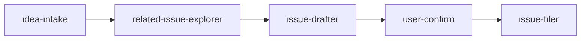

# issue-creation-and-explorer

Search existing GitHub issues, draft a form-shaped issue from a short
repo read, and create it with `gh` after explicit confirmation.

This is a `maiconfz` community package, not an official agents-repo
product. Installed agents reply in the **language the user used**
(English if mixed or unclear).

## Objective

Turn a future-implementation idea into a filed GitHub issue. The flow
checks open and closed issues for overlap, mirrors the target
repository's issue form, and runs `gh issue create` only after an
explicit yes.

This package sits between:

- `maiconfz/feature-exploration-planner` (feature-brief, no `gh`)
- `maiconfz/github-interactive-issue-implementation-planner` (an issue
  already exists)

It does not do landscape research and it does not write an
implementation plan.

## Workflow



`user-confirm` is a gate, not an agent. Search and draft stay plan-safe.
Filing runs only after an explicit yes.

## Prerequisites

- [GitHub CLI](https://cli.github.com/) authenticated for the target
  repository (`gh auth status`)
- A local checkout when the idea should be grounded in that repo

## Install

Prefer the official [agents-repo CLI](https://github.com/agents-repo/cli).

Greenfield (no usable `agents.json` targets yet):

```bash
npx agents-repo@latest init --targets cursor
npx agents-repo@latest install maiconfz/issue-creation-and-explorer
```

Already configured (targets present in `agents.json`):

```bash
npx agents-repo@latest install maiconfz/issue-creation-and-explorer
```

- Choose `--targets` for your IDE: `github-copilot`, `cursor`,
  `claude-code`, or `openai-codex` (pass one or more).
- After install, commit `agents.json`, `agents-lock.json`, and the
  extracted install paths when they change.
- Extract paths follow the install target (see
  [install-targets](https://github.com/agents-repo/registry/blob/main/specs/install-targets.md));
  invoke the flow or agents by name below.

This README is catalog documentation on `main`; installed content comes
from the versioned deployment ZIPs pinned in your `agents-lock.json`.

## Usage

Invoke **`issue-explore-and-create`** with a future-implementation idea.
Optional: invoke a single agent when you need one step only.

### Inputs

| Input | Required | Description |
| --- | --- | --- |
| `idea` | yes | Prompt text or a pasted feature-brief |
| `repository` | no | `owner/name` when the checkout is ambiguous |
| `issue-kind` | no | `feature`, `chore`, `docs`, `bug`, or `spec` |
| `user-clarifications` | no | Answers from clarification loops |

### Outputs

- `overlap-report` — related issues and whether drafting must stop
- `issue-draft` — repository, title, labels, and body
- `issue-url` — empty until filing succeeds
- `open-questions` — remaining questions, blocking items first

### After filing

The flow returns the issue URL and a suggested branch name
`<prefix>/<number>-<slug>`. It does not open that branch or a pull
request. Implementation planning is a later session with
`maiconfz/github-interactive-issue-implementation-planner`.

## Package contents

| Asset | Role |
| --- | --- |
| `issue-explore-and-create` (flow) | Primary entry: search, draft, confirm, file |
| `idea-intake` | Resolve repository and issue kind |
| `related-issue-explorer` | Read-only issue search and form read |
| `issue-drafter` | Form-shaped title, labels, and body |
| `issue-filer` | `gh issue create` after an explicit yes |

## Maintainers

From the registry repository root (package authors / registry
contributors):

```bash
PKG=maiconfz/issue-creation-and-explorer
npm run package:validate -- --package "$PKG"
npm run package:build -- --package "$PKG"
npm run package:validate-artifacts -- --package "$PKG" --version 1.0.0
```

Do not author `detail.json` or any files under `versions/`.
